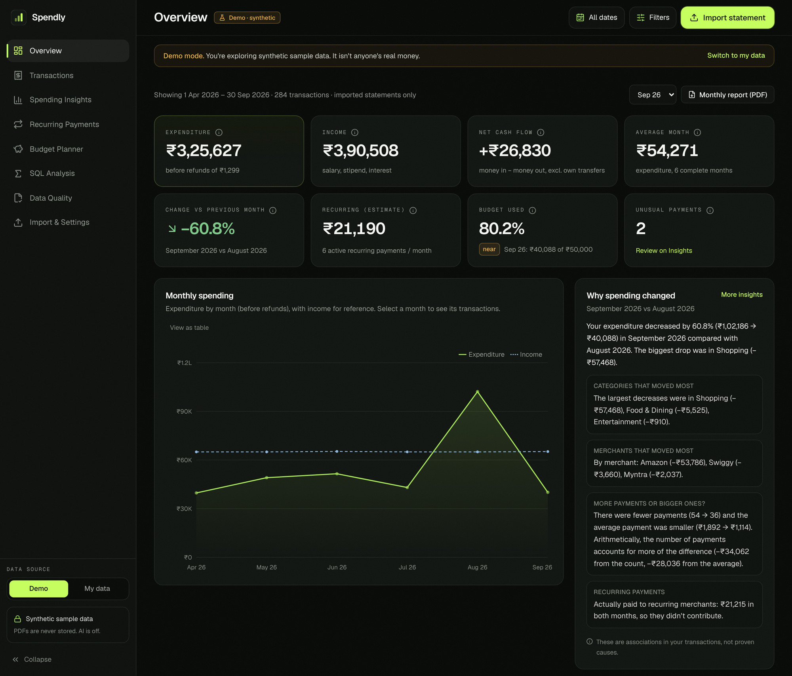
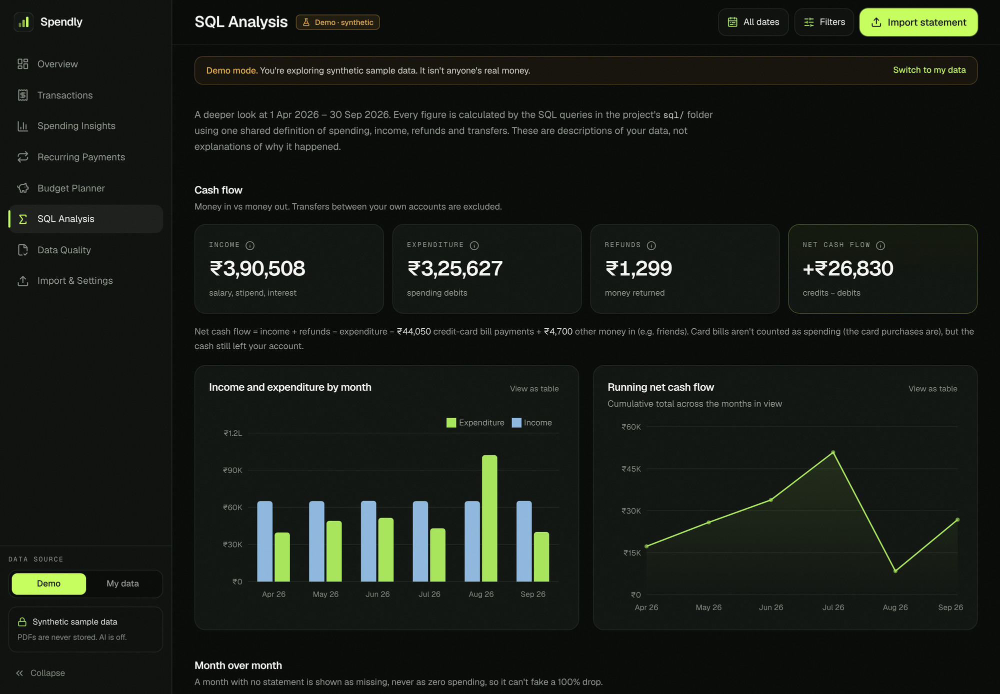
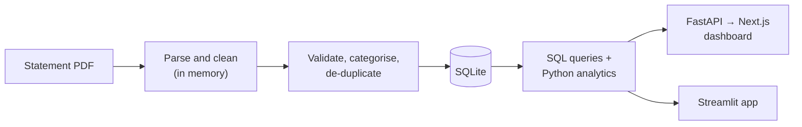

# Spendly

Spendly turns Indian bank and UPI statement PDFs into clean, validated transaction data and analyses it with SQL
to show where the money went and why spending changed from one month to the next. It is built to answer the
questions a statement alone can't: which categories and merchants drove a change, what repeats every month, and
how far the numbers can be trusted.



<p align="center"><sub>Overview dashboard on the built-in synthetic demo data (Apr–Sep 2026). No real financial data appears in this repository. There is no hosted demo; it runs locally (see <a href="#run-locally">Run locally</a>).</sub></p>

## Key highlights

- **End-to-end processing:** statement PDFs are parsed in memory, cleaned, categorised and de-duplicated before
  anything is saved, and the demo data goes through the same pipeline as an upload.
- **Validation and reconciliation:** every import is checked row by row, running balances are verified pair by pair,
  and opening + credits − debits is reconciled against the printed closing balance.
- **SQL-based financial analysis:** 17 commented queries cover month-over-month change, category drivers, merchant
  concentration, weekday vs weekend spending and recurring payments, all from one shared set of metric definitions.
- **Interactive dashboard:** KPIs, trends and drill-downs to the underlying transactions, with plain-language
  explanations of what changed. Missing months are shown as missing, never as zero.

## What Spendly helps analyze

- How much money was spent, earned and kept (net cash flow), and how does that compare month to month?
- Why did spending change from the previous month: which categories and merchants moved, and was it more payments
  or bigger ones?
- Which categories and merchants account for the largest share of expenditure?
- How complete and reliable is the imported data (completeness, validity, duplicates, balance checks)?

It also detects recurring payments, tracks monthly budgets, flags unusually large payments against your own
history, exports CSV, and produces a monthly PDF report.

## SQL and Python skills demonstrated

| Business question | Technique | Where |
|---|---|---|
| Did spending rise or fall each month, and is a "drop" real or a missing statement? | Recursive CTE month calendar, `LAG`, running `SUM` for cumulative cash flow | [`monthly_summary.sql`](sql/monthly_summary.sql) |
| Which categories drove this month's change? | `LAG … PARTITION BY category`, each category's share of the total change, `DENSE_RANK` per month | [`monthly_category.sql`](sql/monthly_category.sql) |
| Who receives the money, and is the average payment misleading? | Median in SQLite with `ROW_NUMBER` + `COUNT() OVER`, `RANK` vs `DENSE_RANK`, cumulative share | [`merchant_stats.sql`](sql/merchant_stats.sql) |
| Is spending concentrated in a few merchants? | Ranking plus the Herfindahl–Hirschman index (sum of squared shares) | [`spending_concentration.sql`](sql/spending_concentration.sql) |
| Do weekends cost more once day counts are fair? | Date calendar, conditional aggregation, spending per calendar day | [`weekend_split.sql`](sql/weekend_split.sql) |
| What repeats on a schedule? | `LAG` over dates for the gap between payments; Python matches the gaps to schedules | [`recurring_candidates.sql`](sql/recurring_candidates.sql) |

On the Python side:

- **Cleaning:** amounts held as integer paise, date parsing that refuses to guess ambiguous formats, merchant name
  normalisation, and masking of account numbers and UPI IDs ([`src/transaction_normalizer.py`](src/transaction_normalizer.py),
  [`src/merchant_normalizer.py`](src/merchant_normalizer.py)).
- **Validation:** row-level checks, running-balance checks, exact vs possible duplicates and a six-dimension quality
  score ([`src/data_validator.py`](src/data_validator.py), [`src/quality.py`](src/quality.py)).
- **KPIs:** expenditure, income, refunds and net cash flow are each defined once in [`src/metrics.py`](src/metrics.py)
  and substituted into every query, so a number means the same thing on every page.
- **Evaluation:** parser accuracy and unusual-payment detection (robust z-score) are measured on labelled synthetic
  data ([parser](docs/PARSER_EVALUATION.md), [anomalies](docs/ANOMALY_EVALUATION.md)).

Example from the synthetic demo data: Amazon's six purchases average ₹10,572 (₹63,431 ÷ 6), but the median is
₹1,949, because one ₹54,999 laptop pulls the average up. Reporting the median alongside the average keeps one
outlier from defining "a typical order". More worked examples with their output:
**[SQL showcase](docs/SQL_SHOWCASE.md)**.

<p align="center"></p>

## Architecture



All calculations happen in the Python and SQL core (`src/`, `sql/`). The Next.js dashboard is the main interface
and the one to try first; the Streamlit app is a lighter view of the same engine with the same numbers.

## Tech stack

| Area | Tools |
|---|---|
| Analysis | Python, SQL (SQLite), pandas |
| Data extraction | pdfplumber |
| Backend | FastAPI |
| Dashboard | Next.js, TypeScript, Tailwind CSS, Recharts |
| Secondary app | Streamlit, Plotly |
| Testing | pytest, Playwright |

## Run locally

**Prerequisites:** Python 3.11+ and Node.js 20+.

**1. Install and start the backend** (from the repository root):

```bash
python -m venv .venv
source .venv/bin/activate            # Windows PowerShell: .venv\Scripts\Activate.ps1
pip install -r requirements-api.txt
uvicorn api.main:app --port 8000
```

**2. Start the dashboard** (in a second terminal):

```bash
cd web
npm install
npm run dev
```

**3. Open** http://localhost:3000 and choose **Try the demo**. It opens on synthetic data, so there is nothing to
upload. To try an import, use the synthetic PDFs in [`data/sample_statements/`](data/sample_statements).

**Streamlit (optional):** with the same virtual environment active, run `streamlit run app.py` and open
http://localhost:8501.

## Testing and validation

Run on 31 Oct 2026 against the current code:

| Check | Result |
|---|---|
| Python tests (`pytest`) | 456 passed, 0 failed |
| Browser end-to-end tests (Playwright), dashboard and Streamlit | 69 passed, 0 failed |
| Lint, type check and production build of the dashboard | All clean |

A manual test with six synthetic statements (bank, multi-page, PhonePe, messy, overlapping and password-protected)
matched every checked figure to the source data and led to 20 fixes. Details are in the [QA report](docs/QA_REPORT.md).

## Limitations

- Two statement layouts are supported: a bank table (Date, Description, Debit, Credit, Balance) and a PhonePe-style
  UPI statement. Other banks may need a new parser.
- Scanned or photographed PDFs are not supported (no OCR); they are rejected with a message.
- All testing used synthetic statements, so accuracy on real statements is unmeasured.
- It is a single-user local app with no accounts. Imported transactions are stored in an unencrypted SQLite file
  (PDFs are never saved). A public deployment would keep each visitor's data in memory for their session only.
- Recurring payments need at least three payments to be detected; unusual-payment detection was evaluated on
  synthetic labels only.
- Optional Gemini features (off by default) can suggest categories for unknown merchants and summarise insights.
  Only sanitised merchant labels are sent, after the user confirms the list. There is no evidence that they improve
  accuracy.

## Documentation

- [SQL showcase](docs/SQL_SHOWCASE.md): six queries with the business question, technique and output
- [Technical guide](docs/TECHNICAL_GUIDE.md): every feature, metric definition, design decision and deployment option
- [QA report](docs/QA_REPORT.md) · [Security review](docs/SECURITY.md)
- [Parser evaluation](docs/PARSER_EVALUATION.md) · [Anomaly evaluation](docs/ANOMALY_EVALUATION.md)
