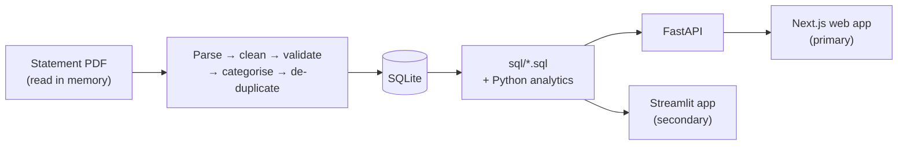
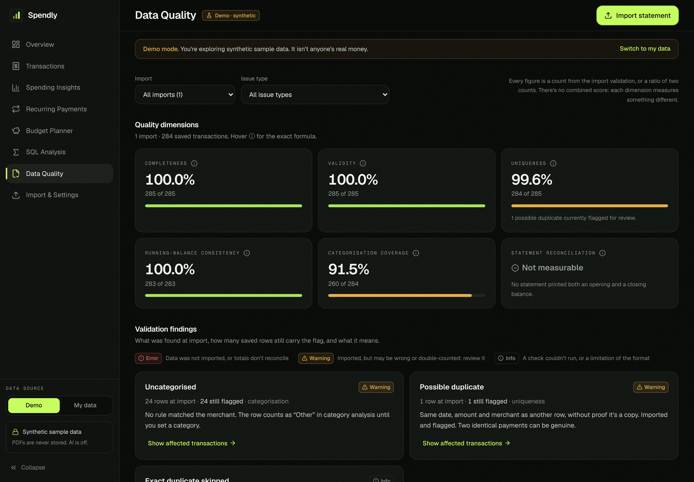

# Spendly

**Spendly turns Indian bank and UPI statement PDFs into clean transaction data, SQL-powered financial analysis
and an interactive dashboard that explains where the money went and why spending changed.**


<sub>The web app's Overview on the built-in synthetic demo data (Apr–Sep 2026). No real person's data is shown anywhere in this repository.</sub>

Repository: [github.com/Sujal-tyagi17/Spendly](https://github.com/Sujal-tyagi17/Spendly) · There is no hosted demo yet; it runs locally in about two minutes ([below](#run-it-locally)).

## Highlights

- **End-to-end analyst workflow:** PDF extraction → cleaning and validation → SQL analysis → explanation, with the
  demo data going through exactly the same pipeline as an uploaded statement.
- **Data quality you can measure:** six quality dimensions, running-balance and opening/closing reconciliation,
  exact vs possible duplicates, and an import preview where nothing is saved until you confirm.
- **SQL does the analysis:** 17 commented queries using CTEs, a recursive calendar, `LAG`, running totals, `RANK`,
  a median in SQLite and an HHI concentration index. One shared definition of each metric.
- **Honest numbers:** a month with no statement is shown as missing, never as zero spending; estimates are labelled
  as estimates; "why spending changed" describes associations, not causes.

## What the dashboard answers

| Question | Where |
|---|---|
| How much did I spend and earn, and what's my net cash flow? | Overview KPIs (Indian number format, e.g. ₹3,25,627) |
| How is spending trending month by month? | Overview chart, SQL Analysis month-over-month table |
| Why did spending change this month? | "Why spending changed": categories, merchants, more payments vs bigger ones |
| Where does the money go? | Categories, top merchants, concentration, weekday vs weekend per day |
| What repeats every month? | Recurring Payments (needs 3+ payments), with confirm / reject |
| Am I within budget? | Budget Planner: overall and per-category variance |
| Which payments look unusual? | Robust z-score against your own history, evaluated in [docs/ANOMALY_EVALUATION.md](docs/ANOMALY_EVALUATION.md) |
| Can I trust these numbers? | Data Quality scorecard and per-import validation report |

Also: transaction search and corrections (fixes are remembered as rules for future imports), CSV export, and a
monthly PDF report.

## SQL and Python skills demonstrated


| Skill | Example in this repo |
|---|---|
| Window functions | `LAG` for month-over-month and gaps between payments; running `SUM` for cumulative cash flow; `RANK` / `DENSE_RANK` |
| CTEs and recursive CTEs | A month calendar so empty months still appear; a date calendar for per-day weekend comparison |
| Statistics in SQL | Median via `ROW_NUMBER` + `COUNT() OVER`; Herfindahl–Hirschman concentration index |
| KPI definitions | One definition per metric in [`src/metrics.py`](src/metrics.py), substituted into every query |
| Data cleaning (Python) | Date parsing that refuses to guess, integer paise, merchant normalisation, identifier masking |
| Data validation (Python) | Row-level checks, running-balance check, statement reconciliation, duplicate detection |
| Evaluation | Parser accuracy and anomaly-detection precision/recall on labelled synthetic data |

Six worked examples with the business question, the technique and the real output:
**[docs/SQL_SHOWCASE.md](docs/SQL_SHOWCASE.md)**.

## Architecture



All calculations live in one Python core (`src/` and `sql/`). Both interfaces display its results; the web app
never calculates money in JavaScript.

**Which interface to try:** the **Next.js web app**. It has every page (including Budget Planner and SQL Analysis),
works on phones, and is covered by the browser test suite. The **Streamlit app** is a lighter Python-only view of
the same engine, with the same numbers and theme, kept for quick local runs.

## Technology

| Layer | Tools |
|---|---|
| Data and analytics | Python 3.11+, pandas, pdfplumber, SQLite (SQL in `sql/`) |
| Backend | FastAPI, uvicorn |
| Web app | Next.js, TypeScript, Tailwind CSS, Recharts |
| Secondary app | Streamlit, Plotly |
| Reports and tests | reportlab (PDF report), pytest, Playwright |

## Run it locally

You need Python 3.11+ and Node.js 20+. The app opens on synthetic demo data, so there is nothing to upload.

```bash
python -m venv .venv
source .venv/bin/activate              # Windows PowerShell: .venv\Scripts\Activate.ps1
pip install -r requirements-api.txt
uvicorn api.main:app --port 8000
```

In a second terminal:

```bash
cd web
npm install
npm run dev                             # open http://localhost:3000 and click "Try the demo"
```

Streamlit instead: `pip install -r requirements.txt`, then `streamlit run app.py`.

To try an import, use the synthetic statements in [`data/sample_statements/`](data/sample_statements) (a bank
statement and a PhonePe statement).
Statements you import stay in a local, unencrypted SQLite file (`data/spendly_user.db`); PDFs are never stored.

## Testing

Results on 30 Oct 2026 (re-run after the latest changes):

| Check | Result |
|---|---|
| Python tests (`pytest`) | 456 passed, 0 failed |
| Browser end-to-end (Playwright), web app + Streamlit | 69 passed, 0 failed |
| Web lint, type check, production build | Clean |
| Manual test with six synthetic statements (bank, multi-page, PhonePe, messy, overlapping, password-protected) | All checked figures matched the source data; 20 defects found and fixed |

Details: [docs/QA_REPORT.md](docs/QA_REPORT.md).

## Known limitations

- Two statement layouts are supported: a bank table (Date, Description, Debit, Credit, Balance) and a PhonePe-style
  UPI statement. Other banks may need a new parser.
- Scanned or photographed PDFs are not supported (no OCR); they are rejected with an explanation.
- All testing used synthetic statements. No real bank statement has been run through it.
- Recurring payments need at least three payments to be detected; unusual-payment detection was evaluated on
  synthetic labels only.
- It is a single-user local app. There are no accounts, and the local database is not encrypted. A public
  deployment would keep each visitor's data in memory for their session only
  (see [docs/SECURITY.md](docs/SECURITY.md)).

## Optional: Gemini

Spendly is complete without AI, and AI is off by default. With `SPENDLY_ENABLE_AI=true` and a `GEMINI_API_KEY`
set on the server, it can:

- suggest categories for merchants no rule recognised. Only sanitised merchant labels are sent (digits, UPI IDs and
  account numbers stripped; no amounts, dates or balances), and you see the exact list before sending. Labels can
  include people's names when you paid a person.
- rephrase the computed insights as a short summary. Any number not in the original insights causes the summary
  to be rejected.

Answers outside the category list are discarded, and AI suggestions stay marked for review. Missing keys, timeouts,
rate limits and malformed replies fall back to the rule-based results; these paths are tested. The model is set by
`GEMINI_MODEL` (default `gemini-3.6-flash`). The key never reaches the browser and is never logged. No evaluation
shows that AI improves accuracy, so it is presented only as a convenience.

## More documentation

- [Technical guide](docs/TECHNICAL_GUIDE.md): every feature, metric definition, data model, deployment and design decision
- [SQL showcase](docs/SQL_SHOWCASE.md) · [QA report](docs/QA_REPORT.md) · [Security review](docs/SECURITY.md)
- [Parser evaluation](docs/PARSER_EVALUATION.md) · [Anomaly evaluation](docs/ANOMALY_EVALUATION.md) · [Interview guide](docs/INTERVIEW_GUIDE.md)

<details>
<summary>Data quality screenshot</summary>



</details>
