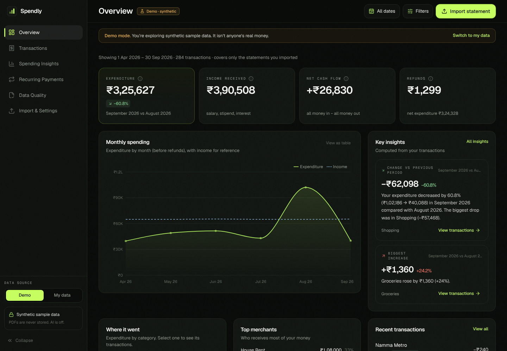
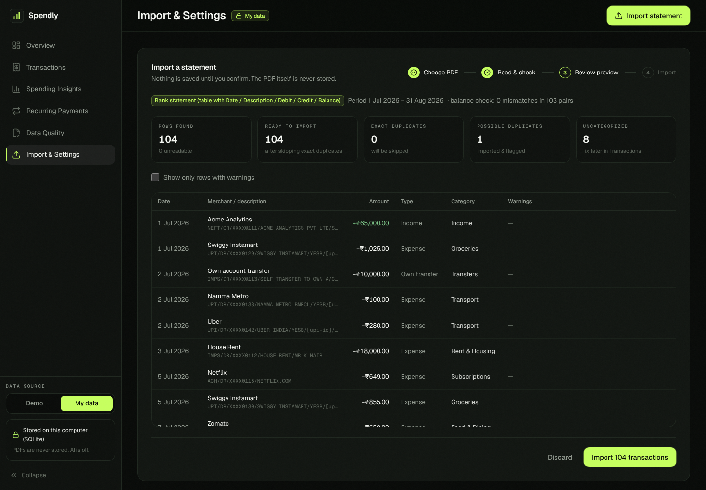
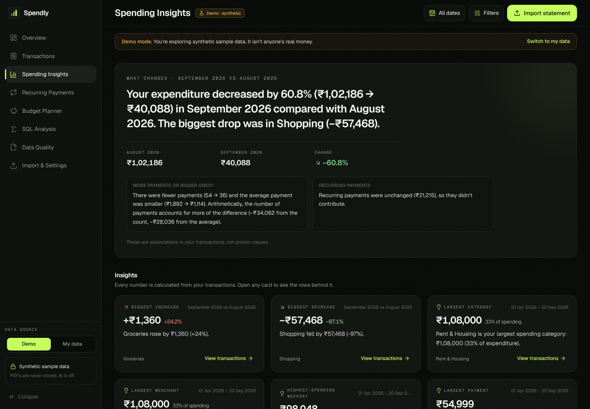
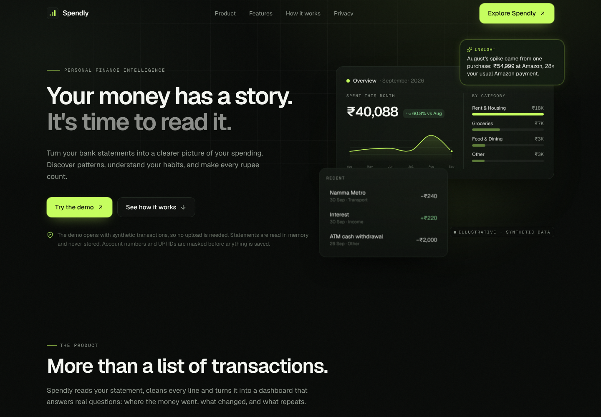
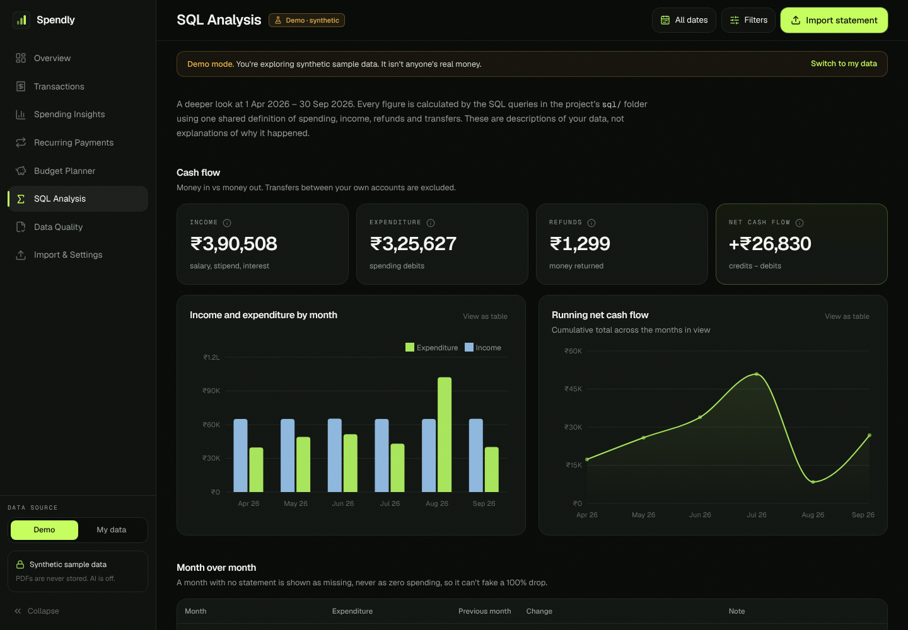

# ₹ Spendly — *Every rupee tells a story.*

Spendly turns raw Indian bank and UPI statement **PDFs** into clean, categorized transactions,
a **SQL-driven analytics engine**, and an interactive dashboard that explains *where your money
went and why your spending changed*.

It is built as a Data Analyst portfolio project that shows the whole workflow end to end:

```
RAW PDF → EXTRACTION → CLEANING → VALIDATION → SQL ANALYSIS → PATTERN DETECTION → VISUALIZATION → INSIGHTS
```

> **Status:** portfolio project. It is careful with your data, but it is **not** a regulated
> financial product. Please read [Known limitations](#23-known-limitations).

### Spendly 2.0 at a glance

Spendly has **one Python core** (`src/` + `sql/`) and two interfaces on top of it:

| Interface | Stack | Run it |
|---|---|---|
| **Web app (2.0)** — redesigned dark fintech UI at `/app`, plus the landing page | Next.js 16 + TypeScript + Tailwind + Motion + Recharts, talking to a thin **FastAPI** layer (`api/`) | see [Spendly 2.0: web app + API](#spendly-20-web-app--api) |
| **Classic app** | Streamlit (`app.py`) | `streamlit run app.py` |

Every number in both comes from the same SQL files and Python modules. The web app never calculates
money in JavaScript.

| Web app overview | Import preview (nothing saved until you confirm) |
|---|---|
|  |  |
| **Spending insights** | **Landing page** |
|  |  |


---

## Contents
1. [Problem statement](#2-problem-statement) · 2. [Features](#3-features) · 3. [Screenshots](#4-screenshots) ·
4. [Tech stack](#5-technology-stack) · 5. [Architecture](#6-architecture-overview) ·
6. [Project structure](#7-project-structure) · 7. [Installation & running](#8-installation) ·
8. [Database schema](#13-database-schema) · 9. [Supported PDF formats](#14-supported-pdf-formats) ·
10. [Analytics methodology & metric definitions](#16-analytics-methodology) · 11. [SQL concepts](#17-sql-concepts-demonstrated) ·
12. [Recurring payments](#18-recurring-payment-detection) · 13. [Anomaly detection](#19-anomaly-detection) ·
[Data-quality scorecard](#data-quality-scorecard) ·
14. [Privacy](#20-privacy-and-security) · 15. [Optional AI](#21-optional-ai-setup) · 16. [Deployment](#22-deployment) ·
17. [Limitations](#23-known-limitations) · 18. [Future work](#24-future-improvements) ·
19. [Budget Planner](#budget-planner)

---

## 2. Problem statement

A month of UPI life produces dozens of lines like `UPI/DR/412345678901/ZOMATO/YESB/zomato@ybl/Payment`.
Bank statements list them faithfully, but they don't answer the questions people actually have:

- Where did my money go this month? Which category is the biggest?
- **Why** did I spend more than last month — which categories and merchants drove it?
- Which payments are subscriptions, and what do they cost per year?
- Which transactions are unusual compared with my normal spending?
- How much did I receive vs spend, and how reliable is the extracted data?

Spendly answers these from the statement PDF itself, with every number computed deterministically
in SQL/Python and every uncertain step (categorization, duplicates, subscriptions, anomalies)
visibly flagged for review.

## 3. Features

| Area | What it does |
|---|---|
| **PDF import** | Validates type/size/signature, handles password-protected statements, detects scanned PDFs, parses multi-page tables with repeated headers and wrapped narration lines, shows a full preview before import. |
| **Cleaning** | Day-first date parsing that refuses to guess ambiguous dates, `₹1,23,456.50` / `Dr` / `Cr` amount parsing into **integer paise** (no float errors), identifier masking, merchant normalization (`ZOMATO*ORDER123 → Zomato`). |
| **Validation** | **Running-balance check** (`previous balance ± amount = printed balance`) to catch mis-read or missing rows; per-row issue reasons; data-quality report. |
| **Duplicates** | *Exact* duplicates (same balance or transaction ID — overlapping statements, repeated rows) are skipped; *possible* duplicates (two ₹20 chais on one day) are imported and flagged — never deleted automatically. Re-importing the same file is blocked by hash. |
| **Categorization** | Rule registry in `config/rules.json` (55+ Indian merchants, transfer / card-bill / refund / salary rules). Debits aren't all expenses; credits aren't all income. Optional Gemini fallback for unknown merchants. Manual corrections, with "apply to all from this merchant". |
| **SQL analytics** | 17 documented `.sql` files: CTEs, recursive CTEs, window functions (`LAG`, `RANK`, `DENSE_RANK`, running `SUM() OVER`), a SQLite median, conditional aggregation. Metric definitions live in one place (`src/metrics.py`). |
| **Spending intelligence** | "Your expenditure increased by 18%… Food & Dining contributed the largest share" — computed from equal-length periods (partial months compared fairly), with safe zero-denominator handling. |
| **Recurring payments** | Interval + amount-stability detection (weekly / monthly / quarterly / yearly), confidence levels, rationale, estimated monthly/annual cost, "may have been cancelled" hints, confirm/reject controls. |
| **Budget Planner** | Monthly budgets per category plus an overall budget: budget vs actual, utilisation, variance, status, copy from the previous month, a drivers panel, and observed insights kept separate from a clearly labelled pace estimate. Partial and missing months are handled honestly. |
| **Anomalies** | Robust z-score against the user's *earlier* payments at the same merchant or category (no look-ahead), with a plain-English reason. Evaluated against labelled synthetic data and compared with three baselines. Never labelled fraud. Dismiss / mark expected. |
| **Data-quality scorecard** | Six separately reported dimensions (completeness, validity, uniqueness, running-balance consistency, categorisation coverage, opening/closing reconciliation), a structured report per import, severity levels, links to affected rows, and a separate parser-accuracy evaluation. No composite score. |
| **Dashboard** | 6 Streamlit pages, Plotly charts with Indian rupee formatting (₹1.2L, ₹45K), sidebar filters shared by every page, editable transaction table, CSV export, empty states everywhere. |
| **Privacy** | PDFs processed in memory and never saved, identifiers masked before storage, nothing sensitive logged, demo and user data in separate databases, one-click delete, private per-visitor databases on public hosting. |
| **Tests** | 290+ pytest tests on synthetic data, including hand-computed analytics, a ground-truth check of the whole pipeline and the HTTP API. |

## 4. Screenshots

All screenshots use the built-in **synthetic** demo data.

| Overview | Spending Insights |
|---|---|
|  |  |
| **Transactions** | **Recurring Payments** |
|  |  |
| **Data Quality** | |
|  | |

## 5. Technology stack

| Layer | Tool | Why |
|---|---|---|
| Language | Python 3.11+ | |
| PDF extraction | pdfplumber | table + text extraction, password support |
| Cleaning | pandas, `decimal` | money parsed with `Decimal`, stored as integer paise |
| Database | SQLite | zero-setup, real SQL, ships with Python |
| Analytics | SQL (SQLite) | CTEs, window functions — see `sql/` |
| Dashboard | Streamlit | multipage app with `st.navigation` |
| Charts | Plotly | interactive hover, Indian number formatting |
| Tests | pytest (+ reportlab to build synthetic PDFs) | |
| Optional AI | Gemini REST API via `requests` | off by default |

No React, no separate backend, no Docker — it runs with `pip install` and one command.

## 6. Architecture overview

```
                 ┌──────────────────────── src/pipeline.py ────────────────────────┐
 PDF bytes ──► pdf_parser ──► transaction_normalizer ──► data_validator ──► categorizer ──► duplicates ──► database
 (in memory)   (parser per    (dates, paise, masking)    (row issues,      (rules.json,      (exact vs      (SQLite,
                format)                                   balance check)    merchant names)    possible)      one transaction)
                                                                                                                 │
          ┌──────────────────────────────────────────────────────────────────────────────────────────────────┘
          ▼
   sql/*.sql  ◄── analytics.py (parameterized filters) ──►  insights.py · subscription_detector.py · anomaly_detector.py
                                                                         │
                                                                         ▼
                                                    app.py + app_pages/*  (Streamlit UI, charts.py, ui.py)
```

Parsing, cleaning, analytics, database access and presentation are separate modules, so each can be
tested and explained on its own. The demo dataset goes through **exactly the same pipeline** as an uploaded PDF.

## 7. Project structure

```
spendly/
├── app.py                      # Streamlit entry point + navigation (classic UI)
├── api/                        # FastAPI layer over src/ (Spendly 2.0)
├── web/                        # Next.js landing page + web app (Spendly 2.0)
├── app_pages/                  # Overview, Transactions, Spending Insights, Recurring, Data Quality, Import
├── src/
│   ├── config.py               # settings (env-overridable), categories, transaction types
│   ├── money.py                # paise parsing, ₹ formatting with lakh/crore grouping
│   ├── pdf_parser.py           # validation + parser registry (BankTableParser, PhonePeParser)
│   ├── transaction_normalizer.py
│   ├── merchant_normalizer.py
│   ├── rules.py                # loads/validates config/rules.json
│   ├── categorizer.py
│   ├── data_validator.py       # row issues + running-balance check
│   ├── duplicates.py
│   ├── pipeline.py             # preview → commit import flow, demo loader
│   ├── database.py             # schema + data-access layer
│   ├── analytics.py            # runs sql/*.sql with safe filters
│   ├── insights.py             # period comparison + insight templates
│   ├── subscription_detector.py
│   ├── anomaly_detector.py
│   ├── ai.py                   # optional Gemini, validated
│   ├── privacy.py              # masking, log redaction
│   ├── charts.py · ui.py       # presentation helpers (Streamlit)
│   └── sample_pdfs.py          # builds synthetic statement PDFs
├── sql/                        # 12 analytical queries
├── config/rules.json           # merchant aliases + categorization rules
├── data/
│   ├── sample_transactions.csv # synthetic demo data (+ ground-truth labels for tests)
│   └── sample_statements/      # synthetic PDFs to try the upload flow
├── scripts/                    # regenerate the synthetic data / PDFs
├── tests/                      # pytest suite
└── docs/                       # screenshots, interview guide
```

## 8. Installation

```bash
git clone https://github.com/Sujal-tyagi17/Spendly.git
cd Spendly
```

### 9. Virtual environment

```bash
python -m venv .venv
# macOS / Linux
source .venv/bin/activate
# Windows (PowerShell)
.venv\Scripts\Activate.ps1
```

### 10. Dependencies

```bash
pip install -r requirements.txt          # to run the app
pip install -r requirements-dev.txt      # + tests and sample-PDF generator
```

### 11. Launch

```bash
streamlit run app.py
```

Open http://localhost:8501. The app starts in **Demo data** mode, so there's something to explore immediately.

### 12. Run the tests

```bash
pytest
```

## 13. Database schema

| Table | Purpose |
|---|---|
| `transactions` | one row per transaction: `transaction_date`, masked `description`, `normalized_merchant`, `amount_paise` (always > 0), `direction` (debit/credit), `transaction_type`, `category`, `categorization_method`, `review_status`, `is_transfer`, `is_possible_duplicate`, `balance_paise`, `fingerprint`, `source_statement_id` |
| `statements` | one row per imported file: parser, period, file hash (blocks re-imports), rows extracted / imported / invalid / skipped, balance-check result, warnings |
| `categories` | allowed categories (foreign key target) |
| `import_issues` | rows that couldn't be imported and why (no raw values stored) |
| `recurring_decisions` | your confirm / reject choices per merchant |
| `anomaly_reviews` | dismissed / expected alerts, so they don't come back |
| `manual_corrections` | audit log of every manual change |
| `budgets` | one row per month and category (`category` NULL = overall budget), `amount_paise` ≥ 0. A unique index on `(month, COALESCE(category, '*'))` blocks duplicates |

Constraints (`CHECK amount_paise > 0`, `direction IN (...)`, foreign keys) and indexes on date, category,
merchant, statement and fingerprint are created automatically. Imports run in a single database
transaction — a failure leaves nothing half-written.

## 14. Supported PDF formats

Spendly deliberately supports a **documented subset** rather than pretending to read every statement.

| Parser | Layout it reads | Notes |
|---|---|---|
| `bank_table` | Text-based bank statements printed as a table with a header such as *Date / Narration / Withdrawal / Deposit / Balance*, *Txn Date / Description / Debit / Credit / Balance* or *Date / Particulars / Amount / Dr-Cr / Balance* | Header columns are matched by synonyms; repeated headers on each page are skipped; wrapped narration lines are joined; dates are day-first. |
| `phonepe` | PhonePe-style statements printed as text: `Sep 30, 2026  Paid to Zomato  DEBIT  ₹350`, followed by Transaction ID lines | Modeled on the public PhonePe layout. Transaction IDs are used (hashed) for strong duplicate detection. |

Both parsers are tested on **synthetic** PDFs only (`data/sample_statements/`). Real statements vary between
banks and app versions — always check the preview. Not supported yet: scanned/image PDFs (need OCR),
credit-card statements, Google Pay/Paytm exports.

### Adding a statement format

1. In `src/pdf_parser.py`, subclass `StatementParser`, set `name`, `label` and `date_formats`.
2. Implement `can_parse(document)` (cheap layout check) and `parse(document)` (return `RawRow`s — strings only).
3. Add an instance to `PARSERS`.
4. Add a synthetic PDF builder in `src/sample_pdfs.py` and tests in `tests/test_pdf_parser.py`.

Everything after parsing (cleaning, categorization, duplicates, analytics) works automatically.

## 15. Sample data

- **Demo mode** (default) loads `data/sample_transactions.csv`: 285 synthetic rows, April–September 2026 —
  salary, rent, subscriptions with drifting dates and a price change, food delivery, groceries, transport,
  a refund, own-account transfers, credit-card bills, uncategorized local shops, money from a friend,
  two genuine identical chai payments, one repeated row, and a ₹54,999 laptop purchase.
- **Reset demo data** on the *Import & Settings* page rebuilds it.
- To try the upload flow, download the synthetic PDFs from the Import page (or `data/sample_statements/`),
  switch to **My data**, and upload them.
- Regenerate everything with `python scripts/generate_sample_data.py && python scripts/make_sample_pdfs.py`.

The CSV also carries `truth_type` / `truth_category` columns. The app ignores them; the tests use them to
check that every row is classified correctly.

## 16. Analytics methodology

### Financial metric definitions

These are defined once (in SQL) and used identically by every card, chart and insight.

| Metric | Definition |
|---|---|
| **Gross debits** | Sum of every debit, including transfers and card bills. |
| **Expenditure** | Debits with type `expense`. Excludes internal transfers and credit-card repayments. |
| **Refunds** | Credits with type `refund`. |
| **Net (refund-adjusted) expenditure** | Expenditure − refunds. |
| **Income received** | Credits with type `income` (salary, stipend, interest, dividends). Money from friends is *not* income — it stays `other` until you change it. |
| **Total credits** | Every credit. |
| **Internal transfers** | Money moved between your own accounts (both directions). Excluded from spending and from cash flow. |
| **Net cash flow** | All credits − all debits, **excluding internal transfers**. Card-bill payments are included (the money really left the account). |
| **Month-over-month change** | (this month's expenditure − last month's) ÷ last month's. Shown as "—"/"New" when last month was 0 — never a division by zero. |

**Why credit-card repayments are excluded from expenditure:** the purchases on the card are the spending;
counting the bill payment as well would double-count it. **Why compare expenditure before refunds month-over-month:**
so the change can be broken down by category (refunds can't always be attributed to one).

**Comparison periods.** The latest month in view is compared with the previous month. If the latest month is
partial (data ends on the 12th), it is compared with the 1st–12th of the previous month and labelled
"partial month". All results cover **only the uploaded statements** — the dashboard says so.

### Example: month-over-month with `LAG()` (simplified)

```sql
SELECT f.month_start,
       f.expenditure_paise,
       LAG(f.expenditure_paise) OVER (ORDER BY f.month_start) AS prev_expenditure_paise,
       CASE WHEN LAG(f.expenditure_paise) OVER (ORDER BY f.month_start) > 0
            THEN ROUND(100.0 * (f.expenditure_paise - LAG(f.expenditure_paise) OVER (ORDER BY f.month_start))
                       / LAG(f.expenditure_paise) OVER (ORDER BY f.month_start), 1)
       END AS mom_change_pct            -- NULL when the previous month was 0
FROM filled AS f;
```

### Example: empty months still appear (recursive CTE)

```sql
WITH RECURSIVE months(month_start) AS (
    SELECT first_month FROM bounds WHERE first_month IS NOT NULL
    UNION ALL
    SELECT date(month_start, '+1 month') FROM months, bounds WHERE month_start < bounds.last_month
)
SELECT m.month_start, COALESCE(x.expenditure_paise, 0) AS expenditure_paise
FROM months m LEFT JOIN monthly x ON x.month_start = m.month_start;
```

### Example: category share with a window over an aggregate

```sql
SELECT category,
       expenditure_paise,
       ROUND(100.0 * expenditure_paise / NULLIF(SUM(expenditure_paise) OVER (), 0), 1) AS share_pct,
       RANK() OVER (ORDER BY expenditure_paise DESC) AS spend_rank
FROM spend;
```

**Safe filters.** Every query starts with `WITH base AS (SELECT * FROM transactions WHERE 1 = 1 /*FILTERS*/)`.
`analytics.build_filter_clause` fills in a clause whose column names are fixed in code and whose values are
**bound parameters**, so sidebar filters can't inject SQL (there's a test that tries).

## 17. SQL concepts demonstrated

| Concept | Where |
|---|---|
| CTEs (`WITH`) | every file in `sql/` |
| Recursive CTEs: month calendar, day calendar | `monthly_summary.sql`, `monthly_category.sql`, `weekend_split.sql` |
| Conditional aggregation (`SUM(CASE …)`) | `monthly_summary.sql`, `totals.sql`, `weekend_split.sql`, `category_change.sql` |
| `LAG` (with `PARTITION BY`) | `monthly_summary.sql` (overall), `monthly_category.sql` (per category), `recurring_candidates.sql` (days between payments) |
| `RANK` vs `DENSE_RANK` | `merchant_stats.sql` (spend rank vs frequency rank), `monthly_category.sql` (rank in month) |
| Running totals (`SUM() OVER (ORDER BY … ROWS UNBOUNDED PRECEDING)`) | cumulative net cash flow, cumulative merchant share |
| Median without a `MEDIAN` function (`ROW_NUMBER` + `COUNT() OVER`) | `merchant_stats.sql` |
| Named `WINDOW` clause, `EXISTS` sub-queries | `monthly_summary.sql` (statement coverage per month) |
| `CROSS JOIN` grid + `LEFT JOIN` so missing combinations show as 0 | `monthly_category.sql`, `weekday_spending.sql` |
| `NULLIF` / `COALESCE` for zero denominators and empty data | throughout |
| Shared metric definitions (`{{is_expense}}` etc.) | `src/metrics.py`, expanded by `analytics.load_sql` |
| Parameterized queries, indexes, constraints, transactions | `src/database.py`, `src/analytics.py` |

### One definition per metric

What counts as spending, income, a refund, a transfer, or a change in cash flow is written **once**, in
`src/metrics.py`. SQL files use placeholders such as `SUM(CASE WHEN {{is_expense}} THEN amount_paise END)`, and
`analytics.load_sql` expands them before running. A test fails if any SQL file writes the expense rule by hand.
Changing a definition changes every query, chart, API response and insight together.

### Advanced analytical questions

| Question | Query | Why a stakeholder cares |
|---|---|---|
| How did spending change month to month, and was the previous month *really* zero or just missing? | `monthly_summary.sql` (`expenditure_change_paise`, `mom_change_pct`, `prev_status`, `is_covered`, `is_full_month`) | Trend reporting that never shows a fake "−100%" because a statement is missing. |
| Which categories drove this month's change? | `monthly_category.sql` (per-category `LAG`, `share_of_change_pct`, `rank_in_month`) | Turns "spending is up 18%" into "Food explains 70% of the increase", which is something you can act on. |
| Where does the money go, and what's a normal payment? | `merchant_stats.sql` (count, total, average, **median**, share, cumulative share, active months) | The average vs median gap shows when a few big payments distort the picture. |
| Is spending spread out or concentrated? | `spending_concentration.sql` (top-1/5/10 share, HHI) | Shows dependency on a few payees (rent, one marketplace). It's a familiar metric from competition and portfolio analysis. |
| Do weekends look different? | `weekend_split.sql` (totals, averages, **per calendar day**, by category) | A fair comparison that adjusts for 5 weekdays vs 2 weekend days. It's descriptive, not causal. |
| How much of spending is already committed? | `subscription_detector.recurring_spend` (actual payments to active recurring merchants, monthly share) | Fixed vs flexible spending, the starting point for any budget. |
| What is the cash-flow trajectory? | `monthly_summary.sql` (income, expenditure, refunds, net and running net cash flow) | Shows whether money accumulates or drains over the period. |

Everything is available through `GET /api/analysis` and shown on the **SQL Analysis** page of the web app,
using the same global filters as every other page.



### Edge cases handled (and tested)

- **Missing vs zero month:** months with no statement are `is_covered = 0` and have no change value. A covered month
  with no spending is a real `0`.
- **Zero denominator:** `% change` is `NULL` when the previous month is 0. The absolute change is still shown.
- **Partial months:** `is_full_month = 0` when statements don't cover the whole month (labelled "partial").
- **Transfers and card bills:** never counted as spending or income. Card bills *are* counted in cash flow.
- **Refunds:** reported separately, and net expenditure = expenditure − refunds.
- **Duplicates:** exact duplicates are skipped at import, so no analysis counts them twice.
- **Signed values in a Debit/Credit column** (e.g. `-50.00`): flagged as unreadable instead of guessed.
- **Empty data:** every query returns zeros or `NULL`s instead of failing.
- **Precision:** all sums are integer paise. Shares and percentages are rounded only for display.

The tests in `tests/test_advanced_analytics.py` use a hand-made fixture whose expected values are written out by
hand or recomputed with plain Python (`statistics.median`, `datetime` day counts). So a wrong SQL formula can't
pass by agreeing with itself.

### Example insights (synthetic demo data)

- Expenditure fell 60.8% in September vs August (₹1,02,186 → ₹40,088). Shopping explains most of the drop
  (−₹57,468): August included one ₹54,999 purchase.
- The top 5 merchants receive 64.6% of spending. The HHI is ≈1,600 (moderate), mostly because of rent (33%).
- Amazon's average payment (₹10,572) is far above its median (₹1,949), so one large purchase skews the average.
- Weekday spending is ₹1,979 per day vs ₹1,276 per weekend day over the six months.
- 38.9% of spending went to six recurring merchants (rent, gym, phone and streaming).

### Analysis limitations

- **One account at a time:** the data model has no account column, so transfers between accounts are recognised
  only by their description ("SELF TRANSFER", "OWN A/C").
- Concentration and merchant rankings depend on merchant-name normalization. Unrecognised spellings split one
  merchant into two.
- Weekday/weekend and category patterns describe the data. They don't explain behaviour.
- Recurring estimates use median amounts. "Share of expenditure" uses actual payments, which is more reliable.
- Results cover only the imported statements. Coverage gaps are flagged, not filled.

## 18. Recurring-payment detection

For each merchant paid at least 3 times, SQL returns every payment and the days since the previous one.
Then:

1. **Timing:** what share of the gaps fits a schedule — weekly 7±2, monthly 30±5, quarterly 91±10, yearly 365±15 days?
2. **Amount stability:** how far does each amount stray from the median?

| Status | Rule |
|---|---|
| High confidence | every gap fits **and** all amounts within 10% of the median |
| Possible | ≥ 60% of gaps fit **and** amounts within 30% |
| Confirmed / Rejected | your decision, which overrides the detector |

Estimated monthly cost = median amount × payments per month (weekly ×52/12, quarterly ÷3, yearly ÷12);
annual = monthly × 12. Both are labelled **estimates**. If no payment arrived within one period + tolerance,
the card says it "may have been cancelled" and it's left out of the monthly total. Transfers are never
treated as subscriptions. Tolerances live in `src/config.py`.

## 19. Anomaly detection

There's no black-box model. Every flag can be explained in one sentence. Full method and evaluation:
[docs/ANOMALY_EVALUATION.md](docs/ANOMALY_EVALUATION.md).

- Only **expenses** are checked. Refunds, transfers, income and card-bill payments never are.
- Each payment is compared with the user's **earlier** payments (strictly earlier dates, so no future data
  leaks in): the same merchant if it has ≥ 5 earlier payments, otherwise the same category if it has ≥ 8.
  With less history it is **not checked**, and the UI says how many weren't.
- Default rule: **robust z-score ≥ 3.5** (`0.6745 × (amount − median) / MAD`) **and** `amount ≥ 2 × median`.
  MAD = 0 falls back to the mean absolute deviation. Identical earlier amounts make any different amount
  infinitely far, so the ratio rule decides. A merchant-consistency guard stops the 2nd rent payment being
  judged against cheap "Other" purchases.
- Each flag shows the method, the reference (e.g. "11 earlier Shopping payments"), their median and middle half,
  the robust z and the ratio, and a descriptive deviation band (notable / large / extreme). This is not a risk score.
- Flags can be marked expected or dismissed (`anomaly_reviews`). A transaction is never changed.

**Evaluation** on a labelled synthetic dataset (12 months, 58 injected anomalies). Temporal split: tune Jan–Jun,
test Jul–Dec. Results on the test half:

| Method | Precision | Recall | F1 | F1 over 5 other seeds |
|---|---|---|---|---|
| Category threshold rule (baseline) | 0.769 | 0.294 | 0.426 | 0.583 ± 0.108 |
| IQR on full history (previous version, uses future data) | 0.743 | 0.765 | 0.754 | 0.739 ± 0.018 |
| IQR on earlier payments | 0.743 | 0.765 | 0.754 | 0.737 ± 0.004 |
| **Robust z on earlier payments (default)** | 0.788 | 0.765 | 0.776 | 0.773 ± 0.034 |

The improvement is mainly methodological: no look-ahead leakage, and it doesn't depend on the date filter. The accuracy
gain is small (about one standard deviation). A grid search on the tune half overfit, so the a-priori defaults
were kept. Unusually *small* payments are never flagged (a known blind spot), and genuine large purchases are.
Isolation Forest was considered and rejected: there's one feature per group, no real labels, and no explanation.
`python -m scripts.evaluate_anomalies` reproduces every number, and a test checks the committed results match a fresh run.

**Unusual ≠ fraudulent.** These are synthetic labels, not fraud labels. The UI says so.

## 20. Privacy and security

| Practice | Implementation |
|---|---|
| Uploaded PDFs are never written to disk | parsed from `io.BytesIO`; a test checks no file appears |
| Identifiers masked before storage | account/card/reference numbers → `XXXX1234`, UPI IDs → `[upi-id]`, phone numbers → `[phone]` |
| No sensitive logging | the code logs counts only; a redacting log filter is a second line of defence; pdfminer's verbose debug output is silenced; tested |
| PDF passwords | used once to open the file, never stored |
| SQL injection | parameterized queries everywhere; whitelisted column names |
| Separate data | demo and your data live in different SQLite files and can't mix |
| Delete everything | *Import & Settings → Delete all my data* removes all rows and `VACUUM`s the file |
| Public hosting | with `SPENDLY_PUBLIC_DEPLOYMENT=true`, each visitor gets private in-memory databases that disappear with their session |
| AI | off by default; only sanitized merchant labels or computed insight sentences are sent (see below) |

**Honest limitations:** the local database (`data/spendly_user.db`) is a normal, **unencrypted** SQLite file
on your computer. Anyone with access to your user account can open it. Delete it from the app or remove the
file. Masking is pattern-based and may miss unusual identifier formats.

## 21. Optional AI setup

Spendly is complete without AI. To enable Gemini:

```bash
export SPENDLY_ENABLE_AI=true
export GEMINI_API_KEY=your-key        # from Google AI Studio
# optional: export GEMINI_MODEL=gemini-2.5-flash
streamlit run app.py
```

What it does, and the guard-rails:

- **Categorize unknown merchants** (Import page). You see the exact list of sanitized merchant labels before
  sending. No amounts, dates, balances or account details are sent. Answers outside Spendly's category list are
  discarded; accepted ones are marked "AI suggestion — please verify" and stay editable.
- **Summarize insights** (Overview). The model receives only the already-computed insight sentences. If its
  summary contains any number that isn't in those sentences, it's rejected and nothing is shown.
- No "AI confidence %" is displayed — an LLM's self-reported confidence is not a calibrated probability.
- Missing key, rate limits (HTTP 429), timeouts and bad responses all produce friendly messages; the rule-based
  results are kept.

## 22. Deployment

**Locally** — see [Installation](#8-installation).

**Streamlit Community Cloud (free):**

1. Push the repo to GitHub (already done for this repo).
2. On share.streamlit.io → *Create app* → pick the repo, branch `main`, main file `app.py`.
3. In *Advanced settings → Secrets* add:
   ```toml
   SPENDLY_PUBLIC_DEPLOYMENT = "true"
   # optional AI:
   # SPENDLY_ENABLE_AI = "true"
   # GEMINI_API_KEY = "..."
   ```
4. Deploy. The demo works immediately with synthetic data.

Notes: the hosted file system is not persistent, which is why public mode keeps each visitor's data in memory
for their session only. Check Streamlit's current documentation for platform limits before relying on them.
Don't upload real statements to a public instance you don't control — run Spendly locally for those.

## 23. Known limitations

- Only the two documented layouts are supported, and they were tested on synthetic PDFs. Real statements from
  specific banks may need a new parser.
- No OCR: scanned/image statements are rejected with an explanation.
- Categorization is rule-based; local shops and people land in "Other" until you correct them (one correction can
  be applied to all rows from that merchant).
- A credit from a known shop is treated as a refund and flagged for confirmation — it could occasionally be
  something else (e.g. a cashback).
- Duplicate detection without a balance column or transaction ID can only say "possible duplicate".
- Parser accuracy has only been measured on synthetic layouts (see docs/PARSER_EVALUATION.md).
- Unusual-payment detection was evaluated on synthetic labels only, and doesn't look for unusually small payments.
- Insights describe only the uploaded period; missing statements make month comparisons misleading
  (coverage is shown on every page).
- Single-user, local app; the SQLite file is unencrypted.

## 24. Future improvements

- More parsers (HDFC/SBI/ICICI layouts, Google Pay & Paytm exports, credit-card statements) and OCR for scans.
- Learn merchant rules from manual corrections automatically.
- Optional encryption of the local database.
- Export a monthly PDF report.

---

## Spendly 2.0: web app + API

### Architecture

```
 Browser ──► Next.js (web/)                         FastAPI (api/)                    Python core (unchanged)
             • landing page  /                      • validates requests             • src/pipeline.py  (import)
             • app           /app/*   ── /api/* ──► • picks demo / user database ──► • src/analytics.py + sql/*.sql
             • no money maths in JS    (rewrite)    • serializes results             • src/insights.py, subscription_detector.py,
                                                                                       anomaly_detector.py, database.py
```

- **Why an API layer instead of more Streamlit?** `src/` was already separate from the UI, so a thin API could
  reuse it without touching a single SQL query or metric definition. Streamlit can't provide the custom shell,
  drag-and-drop import, editing dialogs and motion the redesign needed. The Streamlit app stays as a fallback.
- **Same-origin calls.** The browser only calls `/api/*` on the Next.js site, and `next.config.ts` forwards those
  calls to FastAPI. The backend address (`SPENDLY_API_URL`) is a server-side setting and is never put into the
  browser bundle.
- **Data modes.** Every request carries `X-Spendly-Mode: demo | user`. Demo data and your data live in separate
  databases and can't be mixed. Importing works only in *My data*.
- **Import is two-step.** `POST /api/import/preview` parses the PDF **in memory** and returns a preview token. The
  PDF bytes are never kept, only the extracted (already masked) rows, and those expire after 30 minutes.
  Nothing is written to the database until `POST /api/import/{token}/commit`.
- **Bulk edits are confirmed.** "Apply this category to every transaction from this merchant" sends the number of
  rows the user agreed to. The API refuses the change if the real number differs.
- **Public hosting.** With `SPENDLY_PUBLIC_DEPLOYMENT=true`, each browser session (`X-Spendly-Session`, a random
  id) gets private in-memory databases. They expire after 2 hours of inactivity, and nothing is written to disk.

API docs are served at `http://localhost:8000/api/docs` (OpenAPI).

### Run locally

```bash
# 1) API (from the repo root, in your virtual environment)
pip install -r requirements-dev.txt          # includes FastAPI, uvicorn, test tools
uvicorn api.main:app --reload --port 8000

# 2) Web app (second terminal)
cd web
npm install
npm run dev                                  # http://localhost:3000  → "Explore Spendly" opens /app
```

The classic Streamlit app still works: `streamlit run app.py`.

### Environment variables

| Variable | Where | Purpose | Default |
|---|---|---|---|
| `SPENDLY_API_URL` | web (server only) | where `/api/*` is forwarded | `http://127.0.0.1:8000` |
| `NEXT_PUBLIC_APP_URL` | web | target of "Explore Spendly" (public URL only) | `/app` |
| `NEXT_PUBLIC_SITE_URL` | web | absolute URL for Open Graph images | `http://localhost:3000` |
| `SPENDLY_PUBLIC_DEPLOYMENT` | API | per-session in-memory data for public hosting | `false` |
| `SPENDLY_CORS_ORIGINS` | API | comma-separated origins allowed to call the API directly | `http://localhost:3000` |
| `SPENDLY_DATA_DIR` | API / Streamlit | folder for the SQLite files | `./data` |
| `SPENDLY_ENABLE_AI`, `GEMINI_API_KEY`, `GEMINI_MODEL` | API / Streamlit | optional AI (off by default; keys stay server-side) | off |
| `SPENDLY_MAX_UPLOAD_MB`, `SPENDLY_MAX_PDF_PAGES` | API / Streamlit | upload limits | `10`, `60` |

### Checks

```bash
pytest                                   # Python core + API (from the repo root)
cd web && npm run lint && npx tsc --noEmit && npm run build
```

### Deploy

1. **API** on any Python host that runs a long-lived process (for example Render or Railway):
   - build: `pip install -r requirements-api.txt`
   - start: `uvicorn api.main:app --host 0.0.0.0 --port $PORT`
   - env: `SPENDLY_PUBLIC_DEPLOYMENT=true`
   - Run a **single worker**: the per-session databases live in that process's memory.
2. **Web** on Vercel:
   - Root Directory: `web`
   - env: `SPENDLY_API_URL=https://your-api-host`, `NEXT_PUBLIC_SITE_URL=https://your-site`
   - Redeploy after changing a variable.

Check your hosts' current request-size and sleep/idle policies. Free tiers often sleep when idle, and a restart
clears every in-memory session.

### 2.0 limitations

- On a public deployment, visitor data is in-memory and per session by design. It disappears on restart or after
  2 hours idle. Run Spendly locally for real statements.
- There are no user accounts. Locally there's one *My data* database per machine.
- AI on/off is a server setting (environment variables), not a toggle in the UI, so API keys never reach the browser.

---

### For interviewers
`docs/INTERVIEW_GUIDE.md` walks through the design decisions and the questions this project is built to answer.

*All data shown in this repository is synthetic. No real person's financial information is included.*

---

## Budget Planner

Plan a budget per category (and/or one overall budget) for any month, then compare it with what your
statements show you actually spent. Page: **/app/budgets** · logic: `src/budgets.py` · SQL:
`sql/budget_vs_actual.sql`, `sql/budget_overall.sql` · tests: `tests/test_budgets.py`.

### Metric definitions

| Metric | Formula | Notes |
|---|---|---|
| Actual | sum of `{{is_expense}}` rows in the month | the same expenditure rule as every other page; transfers, card bill payments and income never count |
| Remaining | budget − actual | negative = overspent |
| Variance | actual − budget | positive = over budget |
| Variance % | (actual − budget) ÷ budget × 100 | undefined (shown as —) when the budget is ₹0 |
| Utilisation % | actual ÷ budget × 100 | undefined when the budget is ₹0; rounded to 1 dp, halves away from zero (same as SQLite `ROUND`) |
| Status | `over` (actual > budget) · `at_limit` (equal) · `near` (≥ 80% used) · `within` · `no_budget` · `no_data` | a ₹0 budget is `over` as soon as anything is spent |

Thresholds live in `src/config.py` (`BudgetSettings`): `SPENDLY_BUDGET_NEAR_PCT` (default 80),
`SPENDLY_BUDGET_PACE_MIN_DAYS` (7), the pace tolerance band (±10%), and the repeated-overspend window
(over budget in at least 2 of the last 3 complete months).

### Storage
Budgets are stored as integer paise in the `budgets` table of the same SQLite database as the transactions,
so demo data, your data and (on public hosting) each browser session keep separate budgets automatically.
The month is stored as its first day (`2026-09-01`); a `CHECK` enforces that format and a non-negative amount,
and a unique expression index prevents two budgets for the same category and month. The demo dataset seeds
synthetic budgets for Jul–Sep 2026; resetting the demo restores them.

### Refund treatment
Refunds are **not** netted against category spending. A refund is categorised as *Refunds*, not as the
category of the original purchase, and statements don't reliably link the two. So a category's actual is
what you paid out; refunds received in the month are shown separately next to the overall figure (with net
spending), never silently subtracted.

### Edge cases
- **Zero budget**: no division; utilisation and variance % are empty, the rupee variance is still shown.
- **Spending equal to budget**: `at_limit`, not `over`.
- **Month with no statement**: `no_data` and "spending unknown", never ₹0. You can still plan budgets for it.
- **Partial month** (statement stops mid-month): figures are labelled "so far". The spending **pace** is
  shown only when the data starts on day 1 and covers at least 7 days. It's a linear projection, labelled as
  an estimate and kept apart from observed results. A partial month is never treated as a full one, and it's
  excluded from month-on-month and repeated-overspending comparisons.
- **Spending in categories without a budget** is listed separately and counted in "outside category budgets".
- **Category budgets adding up to more than the overall budget** are flagged, not blocked.
- Income, Transfers and Refunds can't have a spending budget. Amounts above ₹10 crore are rejected as typos.

### API
| Method & path | Purpose |
|---|---|
| `GET /api/budgets/months` | months that have statement data or budgets, plus the default month |
| `GET /api/budgets?month=YYYY-MM` | category rows, overall summary, coverage, pace, insights and 6-month history |
| `POST /api/budgets` `{month, category \| null, amount}` | create (409 if it already exists, 400 if invalid) |
| `PATCH /api/budgets/{id}` `{amount}` | change the amount |
| `DELETE /api/budgets/{id}` | delete (the UI asks for confirmation first) |
| `POST /api/budgets/copy` `{from_month, to_month, overwrite}` | copy all budgets; existing ones are kept unless `overwrite` |
| `GET /api/budgets/drivers?month&category` | merchants behind a category and what changed vs the previous month |

All business logic (status, variance, pace, insights) is in Python and SQL; the web app only displays it.

### Insights (wording rules)
Each insight is marked **observed** or **estimate**. Observed: overall budget vs actual, categories over budget,
largest overspend (in rupees), categories near the limit, spending without a budget, the biggest utilisation
change vs the previous full month, and categories repeatedly over budget. The wording describes what happened
and never calls spending bad or unhealthy. A repeated overspend is described as the budget possibly not
matching usual spending, not as a problem with the spending.

### Example use cases (synthetic demo data)
- **September 2026:** ₹40,088 spent of a ₹50,000 overall budget (80.2%, near limit). Groceries went ₹485 over
  (107.5%); "Why?" shows Blinkit, Swiggy Instamart and BigBasket. Rent is exactly at its limit.
- **August 2026:** a ₹54,999 laptop puts Shopping and the overall budget far over. One click opens those
  transactions.
- **October 2026:** no statement yet. Copy September's budgets to plan ahead; every row shows "spending unknown".

---

## Data-quality scorecard

Page: **/app/quality** · code: `src/quality.py` (dimensions, import report), `src/data_validator.py` (balance
check, reconciliation) · tests: `tests/test_quality.py`.

### Audit: what already existed and what was added

| Check | Before | Now |
|---|---|---|
| Missing date / amount / description | rejected with a reason | same, now coded (`missing_date` …) and counted per import |
| Invalid / ambiguous dates | rejected, never guessed | same; ambiguous dates counted separately |
| Zero amount | reported as "missing" | its own code `zero_amount`: a present value, not a gap |
| Exact duplicates | skipped | same. A verbatim repeated row no longer *also* counts as a balance break |
| Possible duplicates | imported and flagged | same; reported separately from exact duplicates |
| Running-balance check | counts per statement | plus a per-row `balance_check` flag, so affected rows can be opened |
| Missing categories | `categorization_method = 'none'` | coverage % and breakdown by method |
| Merchant normalisation | `Unknown` merchant | counted and linkable (`unknown_merchant`) |
| Invalid transaction types | blocked by a database `CHECK` | unchanged (can't occur in stored data) |
| Opening vs closing balance | not checked | **new**: printed opening + credits − debits vs printed closing balance |
| Per-import report | a few counts | **new**: structured JSON report stored with each import |

### Dimensions

Value = numerator ÷ denominator × 100 (1 dp). It is **n/a** when the denominator is 0: an empty import isn't "100% complete".

| Dimension | Numerator | Denominator | Included / excluded | Interpretation and limits |
|---|---|---|---|---|
| Completeness | extracted rows with date, amount **and** description | rows extracted | all extracted rows; a 0.00 amount counts as present | Low = rows lost to blank cells. Balance is optional and not required. |
| Validity | rows accepted (every field and business rule passes) | complete rows | incomplete rows are excluded so they aren't counted twice | Low = unreadable or ambiguous dates, zero/negative/two-sided amounts. |
| Uniqueness | accepted rows that aren't exact duplicates | accepted rows | possible duplicates are **not** counted as duplicates | Possible duplicates are shown as a separate count ("candidates"). |
| Running-balance consistency | consecutive pairs where previous balance ± amount = printed balance | pairs that could be checked | statements without a balance column are excluded | n/a for UPI-app statements. One misread row breaks one or two pairs. |
| Categorisation coverage | saved transactions with a category from rule, merchant, AI or manual | saved transactions | current state, after your edits | AI-suggested categories count but are listed as still to verify. |
| Statement reconciliation | statements whose printed opening + credits − debits = printed closing | statements printing both balances | only balances that are *printed* are used; nothing is inferred from the rows | n/a when no statement prints both balances. |

There is **no composite score**. Averaging these would hide which dimension is weak and mix units (rows,
pairs, statements).

### Import report (stored per import, shown before you confirm)

Buckets are mutually exclusive and add up: `extracted = rejected + accepted`, and `accepted = to import + exact
duplicates skipped`. A rejected row is counted once, under its primary reason (missing fields first, then dates,
then amounts). Flags (possible duplicates, uncategorised, needs review, balance mismatches, rows without a balance)
can overlap, so they are never added together. The report stores counts and row numbers only: no descriptions,
amounts of single rows, account numbers or UPI IDs (a test checks this).

### Severity levels

| Severity | Meaning | Examples |
|---|---|---|
| Error | data was not imported, or the totals don't reconcile | missing/invalid/ambiguous date, invalid or zero amount, reconciliation difference |
| Warning | imported, but may be wrong or double-counted | possible duplicate, balance mismatch, uncategorised, unrecognised merchant |
| Info | a check couldn't run, or a limitation of the format | no balance column, exact duplicate skipped |

### Trend, filters, links
The scorecard can be filtered by import and by issue type. The trend chart compares imports and appears
only from the second import; no history is simulated. Findings that exist on saved rows (possible duplicates,
uncategorised, balance mismatches, unrecognised merchants) link to exactly those transactions.

### Parser evaluation
Parser accuracy (did we read what's printed?) is measured separately from data quality:
[docs/PARSER_EVALUATION.md](docs/PARSER_EVALUATION.md). Five synthetic fixtures (233 rows: single page,
multi-page, wrapped narration, refunds, PhonePe without balances) are read with 100% date, amount and description
accuracy. That's expected, because the parsers were written for these layouts. **No real statements have been
evaluated**, so no real-world accuracy is claimed. A test tampers with the ground truth to prove the evaluator
detects errors.

### Test fixtures
`tests/test_quality.py` builds small statements by hand, with expected counts written out: missing fields,
invalid and ambiguous dates, zero amounts, verbatim duplicates, possible duplicates, a misprinted balance, refunds,
a 110-row multi-page PDF with a wrapped line, an empty statement, a PhonePe statement without balances, printed
opening/closing balances that do and don't reconcile, an old database without the new columns, and the API filters.

### Limitations
- Reconciliation needs printed opening and closing balances. Many statements print them in layouts the current
  parsers don't read, and then it's n/a.
- Completeness can only count rows the parser saw. A row the parser skipped entirely is invisible to it, but the
  balance chain or reconciliation usually catches it.
- Reports are stored from this version on. Older imports show "no stored report" and are excluded from the
  dimensions that need one.
