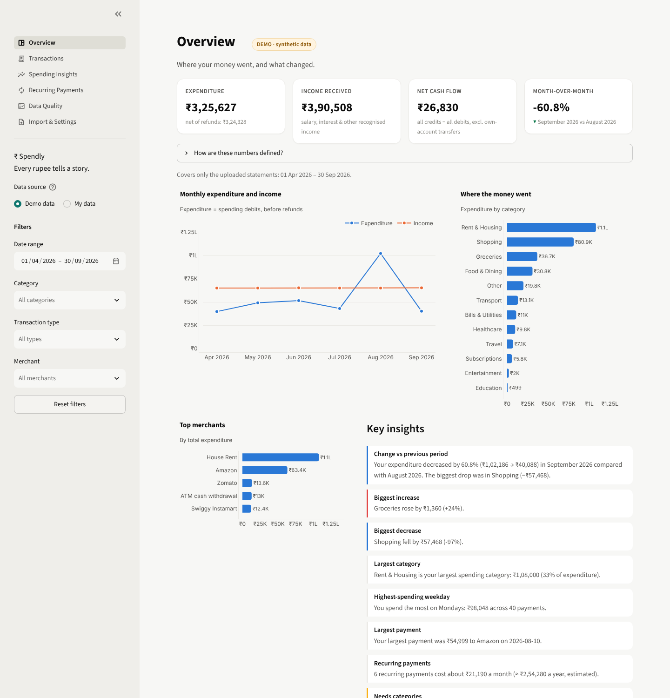
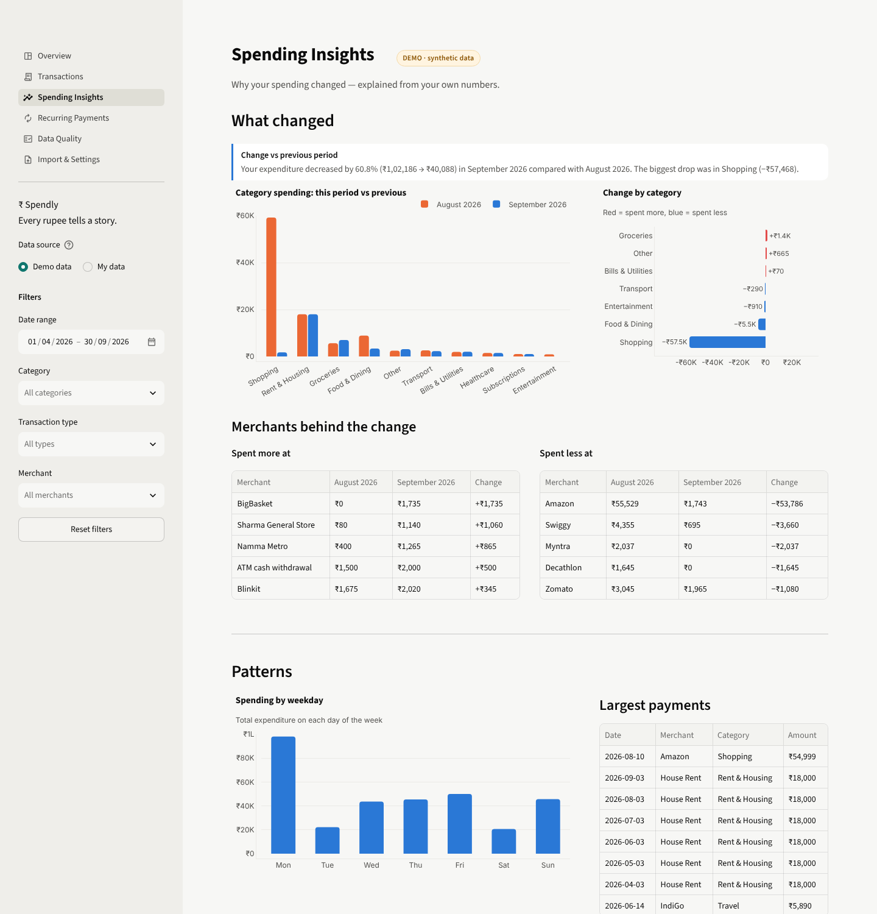
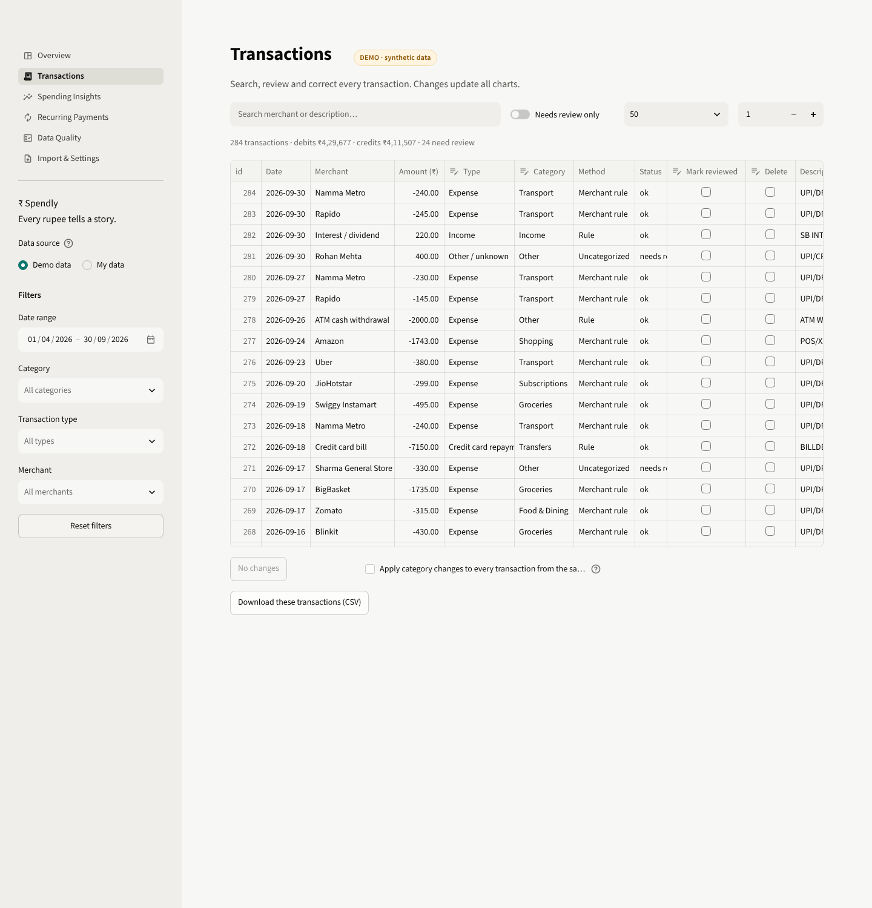
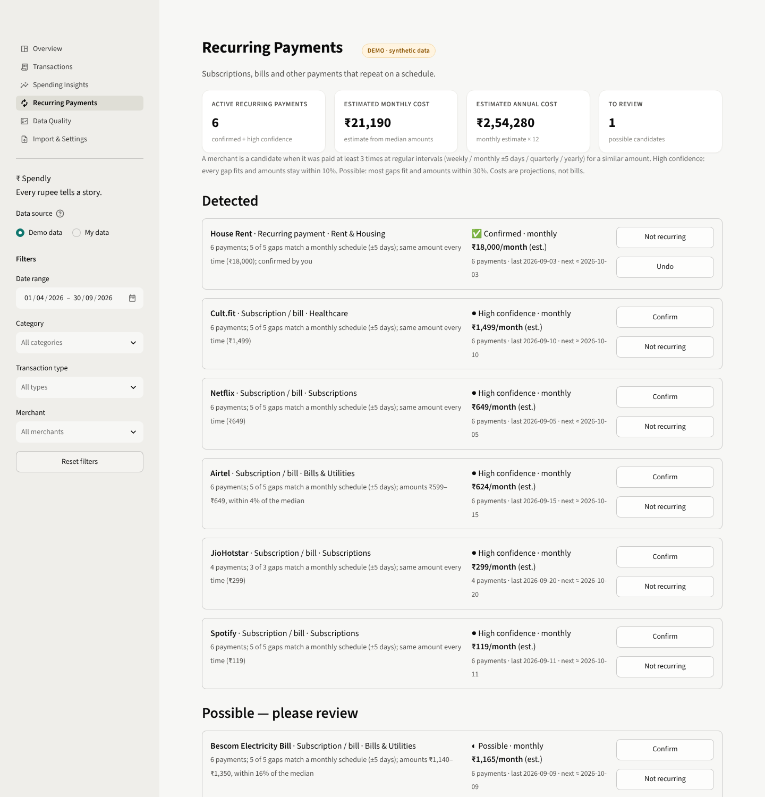
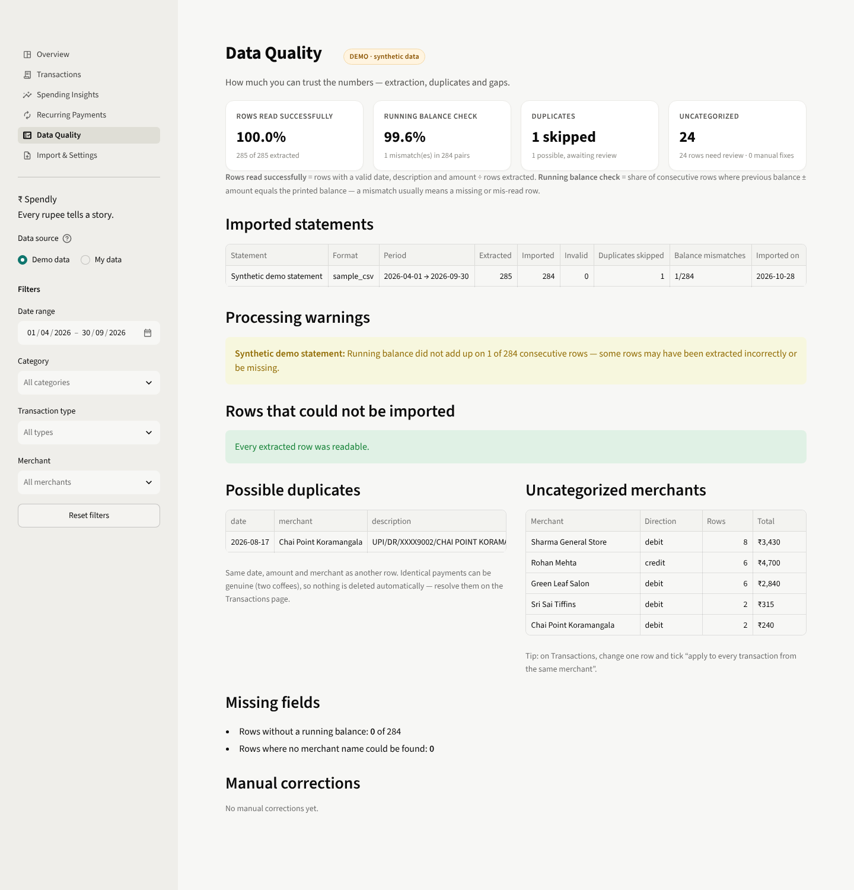

# ₹ Spendly — *Every rupee tells a story.*

Spendly turns raw Indian bank and UPI statement **PDFs** into clean, categorized transactions,
a **SQL-driven analytics engine**, and an interactive dashboard that explains *where your money
went and why your spending changed*.

It is built as a Data Analyst portfolio project that shows the whole workflow end to end:

```
RAW PDF → EXTRACTION → CLEANING → VALIDATION → SQL ANALYSIS → PATTERN DETECTION → VISUALIZATION → INSIGHTS
```

> **Status:** portfolio project. It is careful with your data, but it is **not** a regulated
> financial product. Please read [Known limitations](#23-known-limitations).



---

## Contents
1. [Problem statement](#2-problem-statement) · 2. [Features](#3-features) · 3. [Screenshots](#4-screenshots) ·
4. [Tech stack](#5-technology-stack) · 5. [Architecture](#6-architecture-overview) ·
6. [Project structure](#7-project-structure) · 7. [Installation & running](#8-installation) ·
8. [Database schema](#13-database-schema) · 9. [Supported PDF formats](#14-supported-pdf-formats) ·
10. [Analytics methodology & metric definitions](#16-analytics-methodology) · 11. [SQL concepts](#17-sql-concepts-demonstrated) ·
12. [Recurring payments](#18-recurring-payment-detection) · 13. [Anomaly detection](#19-anomaly-detection) ·
14. [Privacy](#20-privacy-and-security) · 15. [Optional AI](#21-optional-ai-setup) · 16. [Deployment](#22-deployment) ·
17. [Limitations](#23-known-limitations) · 18. [Future work](#24-future-improvements)

---

## 2. Problem statement

A month of UPI life produces dozens of lines like `UPI/DR/412345678901/ZOMATO/YESB/zomato@ybl/Payment`.
Bank statements list them faithfully, but they don't answer the questions people actually have:

- Where did my money go this month? Which category is the biggest?
- **Why** did I spend more than last month — which categories and merchants drove it?
- Which payments are subscriptions, and what do they cost per year?
- Which transactions are unusual compared with my normal spending?
- How much did I receive vs spend, and how reliable is the extracted data?

Spendly answers these from the statement PDF itself, with every number computed deterministically
in SQL/Python and every uncertain step (categorization, duplicates, subscriptions, anomalies)
visibly flagged for review.

## 3. Features

| Area | What it does |
|---|---|
| **PDF import** | Validates type/size/signature, handles password-protected statements, detects scanned PDFs, parses multi-page tables with repeated headers and wrapped narration lines, shows a full preview before import. |
| **Cleaning** | Day-first date parsing that refuses to guess ambiguous dates, `₹1,23,456.50` / `Dr` / `Cr` amount parsing into **integer paise** (no float errors), identifier masking, merchant normalization (`ZOMATO*ORDER123 → Zomato`). |
| **Validation** | **Running-balance check** (`previous balance ± amount = printed balance`) to catch mis-read or missing rows; per-row issue reasons; data-quality report. |
| **Duplicates** | *Exact* duplicates (same balance or transaction ID — overlapping statements, repeated rows) are skipped; *possible* duplicates (two ₹20 chais on one day) are imported and flagged — never deleted automatically. Re-importing the same file is blocked by hash. |
| **Categorization** | Rule registry in `config/rules.json` (55+ Indian merchants, transfer / card-bill / refund / salary rules). Debits aren't all expenses; credits aren't all income. Optional Gemini fallback for unknown merchants. Manual corrections, with "apply to all from this merchant". |
| **SQL analytics** | 12 documented `.sql` files using CTEs, recursive CTEs, window functions (`LAG`, `RANK`, `SUM() OVER`), conditional aggregation; every page uses the same metric definitions. |
| **Spending intelligence** | "Your expenditure increased by 18%… Food & Dining contributed the largest share" — computed from equal-length periods (partial months compared fairly), with safe zero-denominator handling. |
| **Recurring payments** | Interval + amount-stability detection (weekly / monthly / quarterly / yearly), confidence levels, rationale, estimated monthly/annual cost, "may have been cancelled" hints, confirm/reject controls. |
| **Anomalies** | Interpretable IQR rule against the same merchant's or category's history, with a plain-English reason. Never labelled fraud. Dismiss / mark expected. |
| **Dashboard** | 6 Streamlit pages, Plotly charts with Indian rupee formatting (₹1.2L, ₹45K), sidebar filters shared by every page, editable transaction table, CSV export, empty states everywhere. |
| **Privacy** | PDFs processed in memory and never saved, identifiers masked before storage, nothing sensitive logged, demo and user data in separate databases, one-click delete, private per-visitor databases on public hosting. |
| **Tests** | 150+ pytest tests on synthetic data, including hand-computed analytics and a ground-truth check of the whole pipeline. |

## 4. Screenshots

All screenshots use the built-in **synthetic** demo data.

| Overview | Spending Insights |
|---|---|
|  |  |
| **Transactions** | **Recurring Payments** |
|  |  |
| **Data Quality** | |
|  | |

## 5. Technology stack

| Layer | Tool | Why |
|---|---|---|
| Language | Python 3.11+ | |
| PDF extraction | pdfplumber | table + text extraction, password support |
| Cleaning | pandas, `decimal` | money parsed with `Decimal`, stored as integer paise |
| Database | SQLite | zero-setup, real SQL, ships with Python |
| Analytics | SQL (SQLite) | CTEs, window functions — see `sql/` |
| Dashboard | Streamlit | multipage app with `st.navigation` |
| Charts | Plotly | interactive hover, Indian number formatting |
| Tests | pytest (+ reportlab to build synthetic PDFs) | |
| Optional AI | Gemini REST API via `requests` | off by default |

No React, no separate backend, no Docker — it runs with `pip install` and one command.

## 6. Architecture overview

```
                 ┌──────────────────────── src/pipeline.py ────────────────────────┐
 PDF bytes ──► pdf_parser ──► transaction_normalizer ──► data_validator ──► categorizer ──► duplicates ──► database
 (in memory)   (parser per    (dates, paise, masking)    (row issues,      (rules.json,      (exact vs      (SQLite,
                format)                                   balance check)    merchant names)    possible)      one transaction)
                                                                                                                 │
          ┌──────────────────────────────────────────────────────────────────────────────────────────────────┘
          ▼
   sql/*.sql  ◄── analytics.py (parameterized filters) ──►  insights.py · subscription_detector.py · anomaly_detector.py
                                                                         │
                                                                         ▼
                                                    app.py + app_pages/*  (Streamlit UI, charts.py, ui.py)
```

Parsing, cleaning, analytics, database access and presentation are separate modules, so each can be
tested and explained on its own. The demo dataset goes through **exactly the same pipeline** as an uploaded PDF.

## 7. Project structure

```
spendly/
├── app.py                      # Streamlit entry point + navigation
├── app_pages/                  # Overview, Transactions, Spending Insights, Recurring, Data Quality, Import
├── src/
│   ├── config.py               # settings (env-overridable), categories, transaction types
│   ├── money.py                # paise parsing, ₹ formatting with lakh/crore grouping
│   ├── pdf_parser.py           # validation + parser registry (BankTableParser, PhonePeParser)
│   ├── transaction_normalizer.py
│   ├── merchant_normalizer.py
│   ├── rules.py                # loads/validates config/rules.json
│   ├── categorizer.py
│   ├── data_validator.py       # row issues + running-balance check
│   ├── duplicates.py
│   ├── pipeline.py             # preview → commit import flow, demo loader
│   ├── database.py             # schema + data-access layer
│   ├── analytics.py            # runs sql/*.sql with safe filters
│   ├── insights.py             # period comparison + insight templates
│   ├── subscription_detector.py
│   ├── anomaly_detector.py
│   ├── ai.py                   # optional Gemini, validated
│   ├── privacy.py              # masking, log redaction
│   ├── charts.py · ui.py       # presentation helpers
│   └── sample_pdfs.py          # builds synthetic statement PDFs
├── sql/                        # 12 analytical queries
├── config/rules.json           # merchant aliases + categorization rules
├── data/
│   ├── sample_transactions.csv # synthetic demo data (+ ground-truth labels for tests)
│   └── sample_statements/      # synthetic PDFs to try the upload flow
├── scripts/                    # regenerate the synthetic data / PDFs
├── tests/                      # pytest suite
└── docs/                       # screenshots, interview guide
```

## 8. Installation

```bash
git clone https://github.com/Sujal-tyagi17/Spendly.git
cd Spendly
```

### 9. Virtual environment

```bash
python -m venv .venv
# macOS / Linux
source .venv/bin/activate
# Windows (PowerShell)
.venv\Scripts\Activate.ps1
```

### 10. Dependencies

```bash
pip install -r requirements.txt          # to run the app
pip install -r requirements-dev.txt      # + tests and sample-PDF generator
```

### 11. Launch

```bash
streamlit run app.py
```

Open http://localhost:8501. The app starts in **Demo data** mode, so there's something to explore immediately.

### 12. Run the tests

```bash
pytest
```

## 13. Database schema

| Table | Purpose |
|---|---|
| `transactions` | one row per transaction: `transaction_date`, masked `description`, `normalized_merchant`, `amount_paise` (always > 0), `direction` (debit/credit), `transaction_type`, `category`, `categorization_method`, `review_status`, `is_transfer`, `is_possible_duplicate`, `balance_paise`, `fingerprint`, `source_statement_id` |
| `statements` | one row per imported file: parser, period, file hash (blocks re-imports), rows extracted / imported / invalid / skipped, balance-check result, warnings |
| `categories` | allowed categories (foreign key target) |
| `import_issues` | rows that couldn't be imported and why (no raw values stored) |
| `recurring_decisions` | your confirm / reject choices per merchant |
| `anomaly_reviews` | dismissed / expected alerts, so they don't come back |
| `manual_corrections` | audit log of every manual change |

Constraints (`CHECK amount_paise > 0`, `direction IN (...)`, foreign keys) and indexes on date, category,
merchant, statement and fingerprint are created automatically. Imports run in a single database
transaction — a failure leaves nothing half-written.

## 14. Supported PDF formats

Spendly deliberately supports a **documented subset** rather than pretending to read every statement.

| Parser | Layout it reads | Notes |
|---|---|---|
| `bank_table` | Text-based bank statements printed as a table with a header such as *Date / Narration / Withdrawal / Deposit / Balance*, *Txn Date / Description / Debit / Credit / Balance* or *Date / Particulars / Amount / Dr-Cr / Balance* | Header columns are matched by synonyms; repeated headers on each page are skipped; wrapped narration lines are joined; dates are day-first. |
| `phonepe` | PhonePe-style statements printed as text: `Sep 30, 2026  Paid to Zomato  DEBIT  ₹350`, followed by Transaction ID lines | Modeled on the public PhonePe layout. Transaction IDs are used (hashed) for strong duplicate detection. |

Both parsers are tested on **synthetic** PDFs only (`data/sample_statements/`). Real statements vary between
banks and app versions — always check the preview. Not supported yet: scanned/image PDFs (need OCR),
credit-card statements, Google Pay/Paytm exports.

### Adding a statement format

1. In `src/pdf_parser.py`, subclass `StatementParser`, set `name`, `label` and `date_formats`.
2. Implement `can_parse(document)` (cheap layout check) and `parse(document)` (return `RawRow`s — strings only).
3. Add an instance to `PARSERS`.
4. Add a synthetic PDF builder in `src/sample_pdfs.py` and tests in `tests/test_pdf_parser.py`.

Everything after parsing (cleaning, categorization, duplicates, analytics) works automatically.

## 15. Sample data

- **Demo mode** (default) loads `data/sample_transactions.csv`: 285 synthetic rows, April–September 2026 —
  salary, rent, subscriptions with drifting dates and a price change, food delivery, groceries, transport,
  a refund, own-account transfers, credit-card bills, uncategorized local shops, money from a friend,
  two genuine identical chai payments, one repeated row, and a ₹54,999 laptop purchase.
- **Reset demo data** on the *Import & Settings* page rebuilds it.
- To try the upload flow, download the synthetic PDFs from the Import page (or `data/sample_statements/`),
  switch to **My data**, and upload them.
- Regenerate everything with `python scripts/generate_sample_data.py && python scripts/make_sample_pdfs.py`.

The CSV also carries `truth_type` / `truth_category` columns. The app ignores them; the tests use them to
check that every row is classified correctly.

## 16. Analytics methodology

### Financial metric definitions

These are defined once (in SQL) and used identically by every card, chart and insight.

| Metric | Definition |
|---|---|
| **Gross debits** | Sum of every debit, including transfers and card bills. |
| **Expenditure** | Debits with type `expense`. Excludes internal transfers and credit-card repayments. |
| **Refunds** | Credits with type `refund`. |
| **Net (refund-adjusted) expenditure** | Expenditure − refunds. |
| **Income received** | Credits with type `income` (salary, stipend, interest, dividends). Money from friends is *not* income — it stays `other` until you change it. |
| **Total credits** | Every credit. |
| **Internal transfers** | Money moved between your own accounts (both directions). Excluded from spending and from cash flow. |
| **Net cash flow** | All credits − all debits, **excluding internal transfers**. Card-bill payments are included (the money really left the account). |
| **Month-over-month change** | (this month's expenditure − last month's) ÷ last month's. Shown as "—"/"New" when last month was 0 — never a division by zero. |

**Why credit-card repayments are excluded from expenditure:** the purchases on the card are the spending;
counting the bill payment as well would double-count it. **Why compare expenditure before refunds month-over-month:**
so the change can be broken down by category (refunds can't always be attributed to one).

**Comparison periods.** The latest month in view is compared with the previous month. If the latest month is
partial (data ends on the 12th), it is compared with the 1st–12th of the previous month and labelled
"partial month". All results cover **only the uploaded statements** — the dashboard says so.

### Example: month-over-month with `LAG()`

```sql
SELECT f.month_start,
       f.expenditure_paise,
       LAG(f.expenditure_paise) OVER (ORDER BY f.month_start) AS prev_expenditure_paise,
       CASE WHEN LAG(f.expenditure_paise) OVER (ORDER BY f.month_start) > 0
            THEN ROUND(100.0 * (f.expenditure_paise - LAG(f.expenditure_paise) OVER (ORDER BY f.month_start))
                       / LAG(f.expenditure_paise) OVER (ORDER BY f.month_start), 1)
       END AS mom_change_pct            -- NULL when the previous month was 0
FROM filled AS f;
```

### Example: empty months still appear (recursive CTE)

```sql
WITH RECURSIVE months(month_start) AS (
    SELECT first_month FROM bounds WHERE first_month IS NOT NULL
    UNION ALL
    SELECT date(month_start, '+1 month') FROM months, bounds WHERE month_start < bounds.last_month
)
SELECT m.month_start, COALESCE(x.expenditure_paise, 0) AS expenditure_paise
FROM months m LEFT JOIN monthly x ON x.month_start = m.month_start;
```

### Example: category share with a window over an aggregate

```sql
SELECT category,
       expenditure_paise,
       ROUND(100.0 * expenditure_paise / NULLIF(SUM(expenditure_paise) OVER (), 0), 1) AS share_pct,
       RANK() OVER (ORDER BY expenditure_paise DESC) AS spend_rank
FROM spend;
```

**Safe filters.** Every query starts with `WITH base AS (SELECT * FROM transactions WHERE 1 = 1 /*FILTERS*/)`.
`analytics.build_filter_clause` fills in a clause whose column names are fixed in code and whose values are
**bound parameters**, so sidebar filters can't inject SQL (there's a test that tries).

## 17. SQL concepts demonstrated

| Concept | Where |
|---|---|
| CTEs (`WITH`) | every file in `sql/` |
| Recursive CTE (month calendar) | `monthly_summary.sql` |
| Conditional aggregation (`SUM(CASE …)`) | `monthly_summary.sql`, `totals.sql`, `category_change.sql` |
| Window functions: `LAG`, `RANK`, `SUM() OVER ()`, `COUNT() OVER (PARTITION BY)` | `monthly_summary.sql`, `category_spending.sql`, `top_merchants.sql`, `recurring_candidates.sql` |
| `LAG` over `julianday()` for gaps between payments | `recurring_candidates.sql` |
| `VALUES` lists + `LEFT JOIN` to fill missing categories | `weekday_spending.sql` |
| `NULLIF` / `COALESCE` for zero denominators and empty data | throughout |
| Date functions (`strftime`, `date(..., 'start of month')`) | throughout |
| Parameterized queries, indexes, constraints, transactions | `src/database.py`, `src/analytics.py` |

## 18. Recurring-payment detection

For each merchant paid at least 3 times, SQL returns every payment and the days since the previous one.
Then:

1. **Timing:** what share of the gaps fits a schedule — weekly 7±2, monthly 30±5, quarterly 91±10, yearly 365±15 days?
2. **Amount stability:** how far does each amount stray from the median?

| Status | Rule |
|---|---|
| High confidence | every gap fits **and** all amounts within 10% of the median |
| Possible | ≥ 60% of gaps fit **and** amounts within 30% |
| Confirmed / Rejected | your decision, which overrides the detector |

Estimated monthly cost = median amount × payments per month (weekly ×52/12, quarterly ÷3, yearly ÷12);
annual = monthly × 12. Both are labelled **estimates**. If no payment arrived within one period + tolerance,
the card says it "may have been cancelled" and it's left out of the monthly total. Transfers are never
treated as subscriptions. Tolerances live in `src/config.py`.

## 19. Anomaly detection

No black-box model — every flag can be explained in one sentence:

- Compare each expense with **similar payments**: the same merchant if it has ≥ 5 payments, otherwise the same
  category if it has ≥ 8.
- Flag it when `amount > Q3 + 1.5 × IQR` (Tukey's rule) **and** `amount ≥ 2 × median` (so tight groups like
  ₹40–₹60 metro rides don't flag trivial differences).
- Show the reason: *"₹54,999 is 28.2× your usual Amazon payments (median ₹1,949, typical upper range ≈ ₹4,304,
  based on 6 payments)."*
- Too little history → skipped and listed, not guessed. Alerts can be dismissed or marked expected.

**Unusual ≠ fraudulent.** The UI states this explicitly.

## 20. Privacy and security

| Practice | Implementation |
|---|---|
| Uploaded PDFs are never written to disk | parsed from `io.BytesIO`; a test checks no file appears |
| Identifiers masked before storage | account/card/reference numbers → `XXXX1234`, UPI IDs → `[upi-id]`, phone numbers → `[phone]` |
| No sensitive logging | the code logs counts only; a redacting log filter is a second line of defence; pdfminer's verbose debug output is silenced; tested |
| PDF passwords | used once to open the file, never stored |
| SQL injection | parameterized queries everywhere; whitelisted column names |
| Separate data | demo and your data live in different SQLite files and can't mix |
| Delete everything | *Import & Settings → Delete all my data* removes all rows and `VACUUM`s the file |
| Public hosting | with `SPENDLY_PUBLIC_DEPLOYMENT=true`, each visitor gets private in-memory databases that disappear with their session |
| AI | off by default; only sanitized merchant labels or computed insight sentences are sent (see below) |

**Honest limitations:** the local database (`data/spendly_user.db`) is a normal, **unencrypted** SQLite file
on your computer. Anyone with access to your user account can open it. Delete it from the app or remove the
file. Masking is pattern-based and may miss unusual identifier formats.

## 21. Optional AI setup

Spendly is complete without AI. To enable Gemini:

```bash
export SPENDLY_ENABLE_AI=true
export GEMINI_API_KEY=your-key        # from Google AI Studio
# optional: export GEMINI_MODEL=gemini-2.5-flash
streamlit run app.py
```

What it does, and the guard-rails:

- **Categorize unknown merchants** (Import page). You see the exact list of sanitized merchant labels before
  sending. No amounts, dates, balances or account details are sent. Answers outside Spendly's category list are
  discarded; accepted ones are marked "AI suggestion — please verify" and stay editable.
- **Summarize insights** (Overview). The model receives only the already-computed insight sentences. If its
  summary contains any number that isn't in those sentences, it's rejected and nothing is shown.
- No "AI confidence %" is displayed — an LLM's self-reported confidence is not a calibrated probability.
- Missing key, rate limits (HTTP 429), timeouts and bad responses all produce friendly messages; the rule-based
  results are kept.

## 22. Deployment

**Locally** — see [Installation](#8-installation).

**Streamlit Community Cloud (free):**

1. Push the repo to GitHub (already done for this repo).
2. On share.streamlit.io → *Create app* → pick the repo, branch `main`, main file `app.py`.
3. In *Advanced settings → Secrets* add:
   ```toml
   SPENDLY_PUBLIC_DEPLOYMENT = "true"
   # optional AI:
   # SPENDLY_ENABLE_AI = "true"
   # GEMINI_API_KEY = "..."
   ```
4. Deploy. The demo works immediately with synthetic data.

Notes: the hosted file system is not persistent, which is why public mode keeps each visitor's data in memory
for their session only. Check Streamlit's current documentation for platform limits before relying on them.
Don't upload real statements to a public instance you don't control — run Spendly locally for those.

## 23. Known limitations

- Only the two documented layouts are supported, and they were tested on synthetic PDFs. Real statements from
  specific banks may need a new parser.
- No OCR: scanned/image statements are rejected with an explanation.
- Categorization is rule-based; local shops and people land in "Other" until you correct them (one correction can
  be applied to all rows from that merchant).
- A credit from a known shop is treated as a refund and flagged for confirmation — it could occasionally be
  something else (e.g. a cashback).
- Duplicate detection without a balance column or transaction ID can only say "possible duplicate".
- Insights describe only the uploaded period; missing statements make month comparisons misleading
  (coverage is shown on every page).
- Single-user, local app; the SQLite file is unencrypted.

## 24. Future improvements

- More parsers (HDFC/SBI/ICICI layouts, Google Pay & Paytm exports, credit-card statements) and OCR for scans.
- Budgets per category with alerts.
- Learn merchant rules from manual corrections automatically.
- Optional encryption of the local database.
- Export a monthly PDF report.

---

### For interviewers
`docs/INTERVIEW_GUIDE.md` walks through the design decisions and the questions this project is built to answer.

*All data shown in this repository is synthetic. No real person's financial information is included.*
